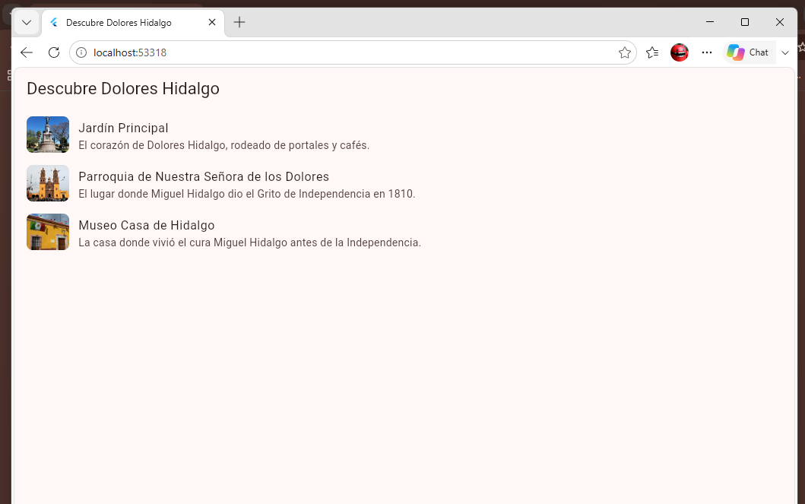
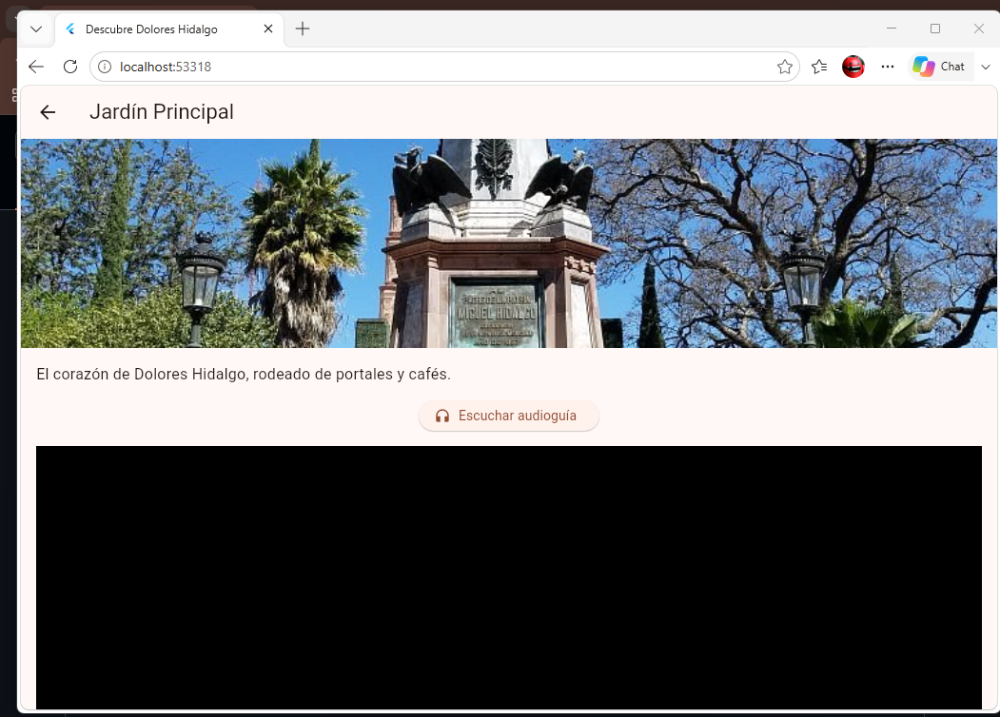
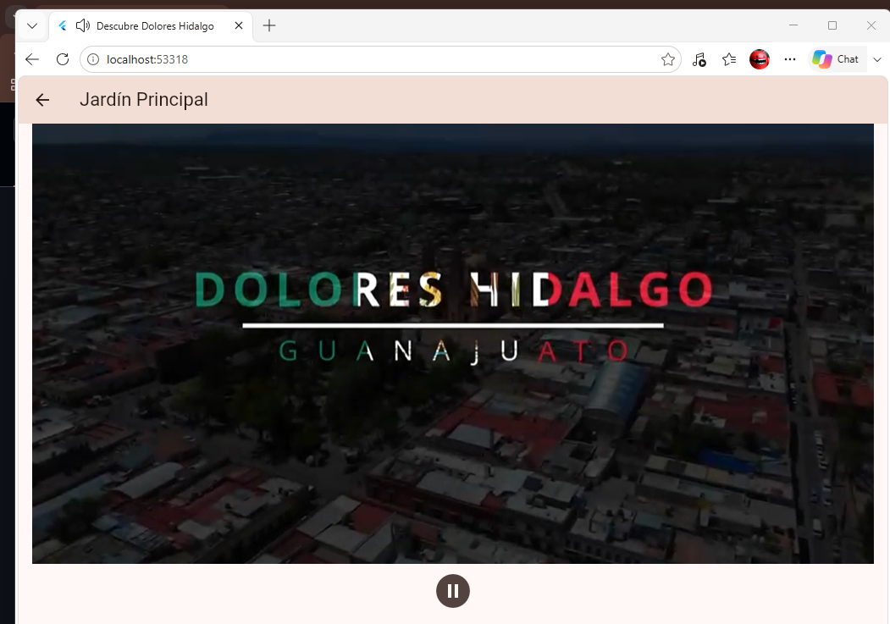
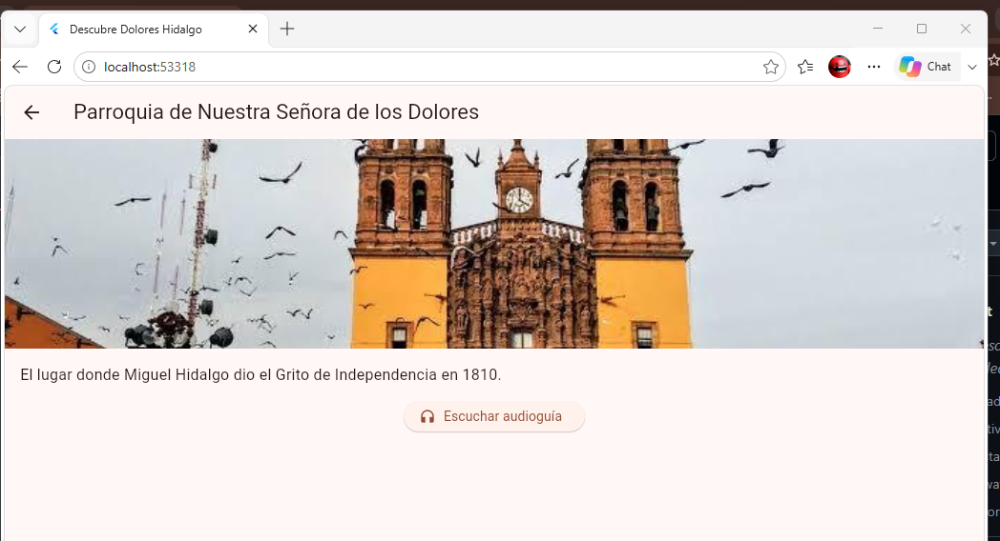
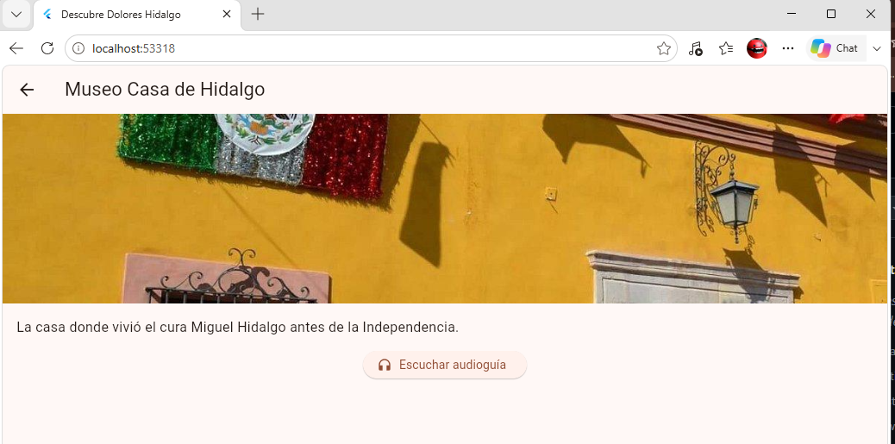

# Práctica 3 · Descubre Dolores Hidalgo

Guía turística multimedia de Dolores Hidalgo hecha con Flutter y **Arquitectura Limpia**. Muestra una lista de lugares emblemáticos y, al entrar a cada uno, una fotografía, una audioguía narrada y, en el Jardín Principal, un video.

- **Alumno:** Oscar Manuel Ayala Ortiz
- **Grupo:** GTID244 · **Núm. de control:** 1225100784
- **Materia:** Desarrollo de Aplicaciones Móviles (UTNG)

## Funcionalidades

- Lista de 3 lugares: Jardín Principal, Parroquia de Nuestra Señora de los Dolores y Museo Casa de Hidalgo.
- Pantalla de detalle con imagen y descripción.
- Botón **Escuchar audioguía / Pausar audioguía**.
- Video del Jardín Principal con botón de reproducir y pausa.
- Los controladores de audio y video se liberan con `dispose()` al salir de la pantalla.

## Arquitectura

La dependencia siempre apunta hacia adentro: **Presentación → Dominio ← Datos**. El Dominio no importa Flutter ni paquetes externos.

```
lib/
├── domain/
│   ├── entities/lugar_turistico.dart       Entidad (Dart puro)
│   ├── repositories/lugares_repository.dart Interfaz del repositorio
│   └── usecases/
│       ├── obtener_lugares.dart            Caso de uso: listar
│       └── obtener_lugar_por_id.dart       Caso de uso: buscar por id
├── data/
│   ├── datasources/lugares_local_datasource.dart  Datos locales de los 3 lugares
│   └── repositories/lugares_repository_impl.dart  Implementa la interfaz del Dominio
├── presentation/
│   ├── viewmodels/
│   │   ├── lugares_view_model.dart         Estado de la lista
│   │   └── detalle_view_model.dart         Estado del detalle (audio)
│   └── views/
│       ├── lista_lugares_screen.dart
│       └── detalle_lugar_screen.dart
└── main.dart                               Composición de dependencias
assets/
├── images/   audio/   video/
```

`main.dart` es el único archivo que conoce las clases concretas de las tres capas y las conecta.

## Paquetes

| Paquete | Para qué sirve |
|---|---|
| `audioplayers` | Reproducir la audioguía |
| `video_player` | Reproducir el video del Jardín |
| `cupertino_icons` | Íconos |

## Cómo ejecutarla

```
flutter pub get
flutter run -d chrome
flutter test
```

## Evidencia de funcionamiento

| Lista de lugares | Jardín Principal |
|---|---|
|  |  |

| Video y audio en el Jardín | Parroquia | Museo Casa de Hidalgo |
|---|---|---|
|  |  |  |

En la captura del video, la pestaña del navegador muestra el ícono de sonido: la audioguía y el video están reproduciéndose.

## Pruebas

5 pruebas en `test/`:

- `obtener_lugares_test.dart` (3): prueba los casos de uso del Dominio con un repositorio falso, sin Flutter ni multimedia.
- `widget_test.dart` (2): prueba el repositorio real (3 lugares, búsqueda por id) y el `LugaresViewModel`.
